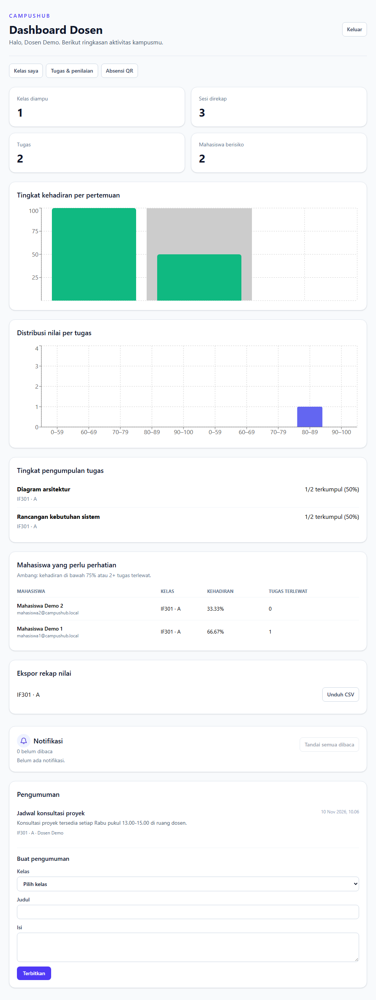
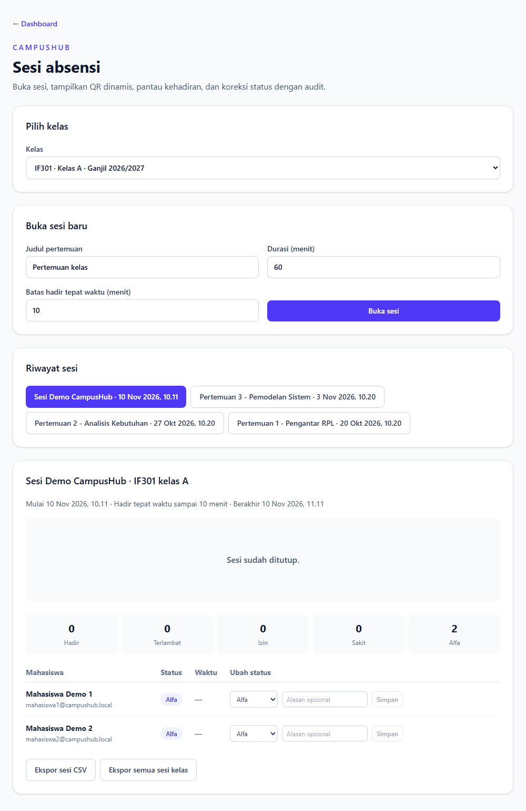
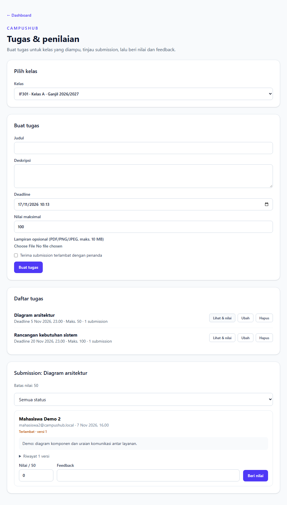
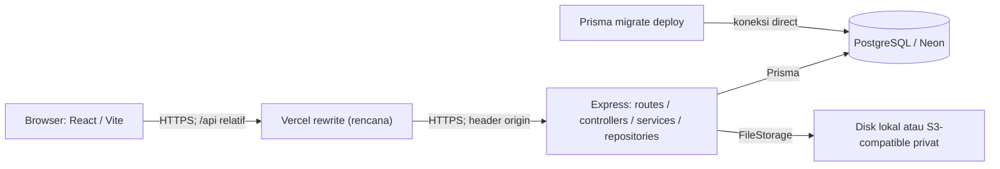
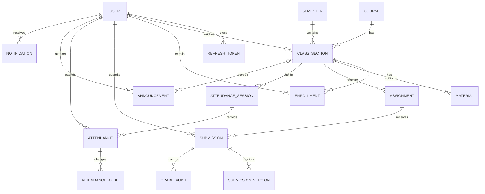

# CampusHub

[](https://github.com/juanfelix1606/CampusHub/actions/workflows/ci.yml)

CampusHub adalah proyek portofolio sistem informasi kampus yang menggabungkan LMS sederhana dan absensi QR. Admin mengelola struktur akademik, dosen mengelola kelas serta penilaian, dan mahasiswa mengakses materi, mengumpulkan tugas, serta mencatat kehadiran. Aplikasi menggunakan React dan Express dalam monorepo TypeScript, PostgreSQL/Prisma, penyimpanan file privat, dashboard analitik, dan pengujian otomatis.

## Demo

**Demo live belum tersedia.** Lihat screenshot di bawah.

Konfigurasi deploy sudah disiapkan (Vercel + Render + Neon + S3) tetapi belum dideploy. Backend Render belum dibuat karena proses pembuatan layanan meminta verifikasi kartu.

Screenshot dibuat dari seed pada PostgreSQL lokal terisolasi:







Screenshot lainnya: [dashboard mahasiswa](docs/screenshots/dashboard-mahasiswa.png), [dashboard admin](docs/screenshots/dashboard-admin.png), [notifikasi mahasiswa](docs/screenshots/notifikasi-mahasiswa.png), dan [daftar tugas mahasiswa](docs/screenshots/tugas-mahasiswa.png).

### Akun demo

Akun berikut dibuat oleh seed untuk lingkungan lokal. Tidak ada akun demo online karena demo live belum tersedia.

| Role | Email |
| --- | --- |
| Admin | `admin@campushub.local` |
| Dosen | `dosen@campushub.local` |
| Mahasiswa | `mahasiswa1@campushub.local` |
| Mahasiswa | `mahasiswa2@campushub.local` |

**Password:** tidak dicantumkan di repositori. Untuk lokal, seluruh akun seed menggunakan `DEMO_PASSWORD` dari environment; gunakan password sementara yang hanya untuk demo. Lihat [panduan deployment](docs/DEPLOYMENT.md) untuk batasan akun admin demo dan cara seed/reset database khusus demo.

## Fitur per role

- **Admin:** kelola mata kuliah dan kelas, lihat dashboard agregat, buat pengumuman, serta ekspor rekap nilai. Semester tersedia dari data database; belum ada fitur pengelolaan semester di UI/API.
- **Dosen:** kelola materi kelas, tugas, penilaian dan feedback; buka sesi QR, pantau/ubah kehadiran dengan audit, ekspor rekap dan buat pengumuman kelas.
- **Mahasiswa:** daftar kelas, unduh materi, kumpulkan tugas, lihat nilai/feedback dan notifikasi, serta check-in QR melalui kamera atau input manual.
- **Bersama:** autentikasi dan proteksi per role, dashboard responsif, pengumuman, notifikasi in-app, serta loading/empty/error state.

## Arsitektur



Diagram menggambarkan target deployment; Neon, provider S3, rewrite dan topologi IP masih perlu diverifikasi di environment nyata. Secara lokal, Vite meneruskan `/api` ke API development.

### ERD ringkas

Relasi berikut adalah subset model utama; schema lengkap dan audit tersedia di [schema Prisma](apps/api/prisma/schema.prisma).



## Tech stack

| Lapisan | Teknologi |
| --- | --- |
| Frontend | React, TypeScript, Vite, Tailwind CSS, React Router, TanStack Query, React Hook Form, Zod, Recharts |
| Backend | Node.js, Express, TypeScript, Zod, JWT, bcrypt, Helmet, rate limiting |
| Data dan file | PostgreSQL, Prisma ORM, filesystem lokal atau AWS SDK v3 untuk S3-compatible |
| Testing dan operasi | Vitest, Supertest, Playwright, Docker Compose, GitHub Actions |
| Target deployment | Vercel, Render, Neon, storage S3-compatible — konfigurasi disiapkan, belum dideploy |

## Struktur

```text
apps/
  api/
    prisma/          Schema, migrasi dan seed
    scripts/         Skrip integration, storage dan demo
    src/modules/     Routes, controllers, services dan repositories per domain
    src/shared/      Utilitas dan komponen bersama
  web/src/           React, fitur dan API client
docs/                Panduan deployment, catatan CV dan screenshot
e2e/                 Pengujian Playwright
.github/workflows/   GitHub Actions
docker-compose.yml   PostgreSQL lokal dan test
```

## Instalasi lokal

Prasyarat: Node.js 20.19+ dan npm, serta Docker Desktop dengan Docker Compose. Langkah berikut menjalankan PostgreSQL lokal melalui Compose dan tidak memerlukan Neon atau provider cloud.

Gunakan PowerShell pada root proyek:

1. Salin contoh konfigurasi dan pasang dependency:

   ```powershell
   Copy-Item .env.example .env
   npm ci
   ```

   Jangan commit `.env`. Jika file sudah ada, jangan menimpanya; tinjau dan sesuaikan nilainya secara lokal.
2. Pada `.env`, pastikan URL menunjuk ke database Compose lokal:
   - `DATABASE_URL` memakai konfigurasi lokal di `.env.example` dan mengarah ke `localhost:5432/campushub`.
   - `TEST_DATABASE_URL` mengarah ke `localhost:5433/campushub_test` (khusus integration test).
   - Biarkan `DIRECT_DATABASE_URL` kosong untuk development lokal agar Prisma memakai `DATABASE_URL`.
   - Isi `DEMO_PASSWORD` dengan password sementara minimal 12 karakter. Isi `JWT_ACCESS_SECRET` dan `ATTENDANCE_QR_SECRET` dengan dua nilai acak berbeda, masing-masing minimal 32 karakter dan 12 karakter unik. Untuk setiap secret, jalankan perintah berikut satu kali; jangan gunakan output yang sama untuk keduanya atau membagikannya:

   ```powershell
   node -e "console.log(require('node:crypto').randomBytes(48).toString('base64url'))"
   ```

3. Jalankan PostgreSQL lokal, migrasi, seed, dan API:

   ```powershell
   docker compose up -d db
   npm run db:generate
   npm run db:migrate
   npm run db:seed
   npm run dev
   ```

4. Di terminal PowerShell kedua, pada root proyek jalankan `npm run dev:web`, lalu buka `http://localhost:5173`. Health API: `http://localhost:3000/api/v1/health`. Dokumentasi Swagger tersedia lokal di `http://localhost:3000/api/docs`; dinonaktifkan di production.

Storage default adalah lokal. File PDF, PNG, dan JPEG dibatasi 10 MB serta divalidasi ekstensi, MIME, dan magic bytes. Storage S3 menggunakan bucket privat; unduhan melewati pemeriksaan akses backend. Konfigurasi provider, smoke test, migrasi Neon, dan reset demo dijelaskan di [panduan deployment](docs/DEPLOYMENT.md).

### Pengujian

```powershell
npm run lint
npm run format:check
npm run build
npm run test:unit
docker compose --profile test up -d db-test
npm run test:integration
```

Integration test menerapkan migrasi dan memodifikasi database yang ditunjuk `TEST_DATABASE_URL`; jangan gunakan database development atau production. CI menjalankan integration untuk storage lokal dan mock S3. Untuk E2E, migrasikan dan seed **database test** dengan `DATABASE_URL` dan `DIRECT_DATABASE_URL` yang menunjuk database test, serta `DEMO_PASSWORD` yang sama, lalu jalankan `npx playwright install chromium` dan `npm run test:e2e`. Playwright menguji dosen membuat dan menilai tugas, mahasiswa submit, serta melihat nilai, feedback dan notifikasi.

## Keputusan desain dan tantangan teknis

| Tantangan | Solusi dan trade-off |
| --- | --- |
| QR dapat dibagikan ulang | JWT bertanda tangan terikat sesi dan slot waktu server 30 detik; enrollment dan unique constraint mencegah check-in ganda. Rotasi membatasi masa berlaku, bukan membuktikan lokasi mahasiswa. |
| Banyak mahasiswa mendaftar bersamaan | Transaksi mengunci baris kelas (`FOR UPDATE`) sebelum menghitung kapasitas; unique constraint menolak enrollment duplikat. Lock menambah serialisasi pada kelas yang sama. |
| Keamanan sesi | Access token berumur pendek; refresh token acak disimpan sebagai hash, dirotasi saat refresh, dan cookie `HttpOnly` memakai `Secure` di production. |
| Nilai tidak boleh melampaui maksimum tugas | Validasi aplikasi didukung constraint dan trigger PostgreSQL pada submission serta perubahan maksimum tugas. |
| CSV injection | Sel CSV di-escape dan nilai yang berpotensi menjadi formula spreadsheet dinetralkan. |
| Satu origin dan proxy | Browser memakai `/api` relatif dan cookie `SameSite=Lax`; konfigurasi rewrite Vercel dirancang menyetel header origin rahasia yang divalidasi backend. Rewrite dan `PROXY_HOPS=2` masih harus diuji di deployment. |
| Penyimpanan file | Interface `FileStorage` memisahkan disk lokal dan S3; key acak serta streaming setelah otorisasi menghindari URL publik permanen. Bucket harus dibuat privat oleh operator. |

## Known issues dan batasan

- Audit terdahulu melaporkan tiga temuan high pada dependency Prisma 6 / `deepmerge-ts` ([GHSA-ggr8-5vv4-36mx](https://github.com/advisories/GHSA-ggr8-5vv4-36mx)) dan tujuh moderate pada tooling `minimatch` ([GHSA-g3hv-75wg-m249](https://github.com/advisories/GHSA-g3hv-75wg-m249)). Ini **snapshot audit sebelumnya**, bukan hasil audit terkini; jalankan `npm audit` dan tinjau perbaikan serta kompatibilitas sebelum rilis publik.
- Smoke test storage terhadap provider S3 nyata (Supabase) berhasil untuk operasi put/get/delete. Namun alur upload dan download materi melalui aplikasi pada production **belum diverifikasi**; CI memakai mock S3 yang tidak menggantikan pengujian provider nyata.
- Aplikasi **belum dideploy**. Alur login, refresh, upload materi, dan scan kamera HP melalui HTTPS di production belum diverifikasi. Konfigurasi `PROXY_HOPS=2` adalah hipotesis dan belum diukur di production; rate limiter saat ini menggunakan memori per instance, bukan pembatas terdistribusi.
- Screenshot pada README dibuat dari seed di cluster PostgreSQL lokal sementara, bukan dari production. Cluster tersebut sudah dibersihkan; empat screenshot lama yang tidak dipakai telah dihapus dari folder dokumentasi.

## Roadmap

1. Selesaikan verifikasi akun hosting, deploy backend dan frontend, lalu uji storage, proxy, dan alur end-to-end; tambahkan URL demo setelah siap.
2. Tinjau advisory dependency dan jalur upgrade yang kompatibel.
3. Perbarui screenshot demo dan pertimbangkan rate limiting terdistribusi bila berjalan pada banyak instance.

## Kontribusi dan lisensi

Lihat [CONTRIBUTING.md](CONTRIBUTING.md) untuk cara berkontribusi. Proyek menggunakan [MIT License](LICENSE).
