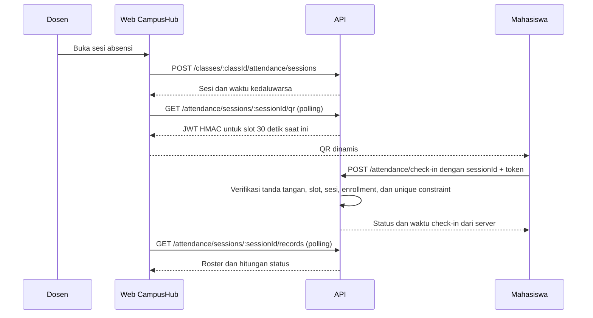

# CampusHub

[](https://github.com/juanfelix1606/CampusHub/actions/workflows/ci.yml)

CampusHub adalah proyek portofolio sistem informasi kampus yang menggabungkan LMS sederhana dan absensi berbasis QR. Proyek ini dibangun sebagai monorepo TypeScript dengan React/Vite, Express, PostgreSQL, dan Prisma.

## Status

Fase 1-5: fondasi monorepo, autentikasi/RBAC, pengelolaan kelas, enrollment dan materi, tugas, submission berversi, penilaian, serta absensi QR dinamis.

## Tech stack

- Frontend: React, TypeScript, Vite, Tailwind CSS, React Router, TanStack Query, React Hook Form, Zod, Recharts, qrcode.react, html5-qrcode
- Backend: Node.js, Express, TypeScript
- Database: PostgreSQL 16, Prisma ORM
- Proteksi dasar API: Helmet, CORS allowlist, rate limiting

## Prasyarat

- Node.js 20.19+ dan npm
- Docker Desktop dengan Docker Compose

## Menjalankan lokal

1. Salin `.env.example` menjadi `.env`, atur `DEMO_PASSWORD` menjadi password lokal sementara (minimal 12 karakter), dan isi `JWT_ACCESS_SECRET` serta `ATTENDANCE_QR_SECRET` dengan secret acak minimal 32 karakter. Generate secret dengan `node -e "console.log(require('node:crypto').randomBytes(48).toString('base64url'))"`. Nilai PostgreSQL di file tersebut harus sama dengan konfigurasi Compose.
2. Jalankan PostgreSQL: `docker compose up -d db`
3. Instal dependency: `npm install`
4. Buat Prisma Client: `npm run db:generate`
5. Terapkan migrasi lokal: `npm run db:migrate`
6. Isi data demo: `npm run db:seed`
7. Jalankan API: `npm run dev`
8. Di terminal lain jalankan frontend: `npm run dev:web`

API health check tersedia di `http://localhost:3000/api/v1/health`; frontend di `http://localhost:5173`.

### Akun seed lokal

Seed membuat akun berikut; seluruh akun memakai nilai `DEMO_PASSWORD` dari `.env`:

- Admin: `admin@campushub.local`
- Dosen: `dosen@campushub.local`
- Mahasiswa: `mahasiswa1@campushub.local`, `mahasiswa2@campushub.local`

Akun dan password tersebut hanya untuk development/demo lokal. Jangan gunakan password produksi atau data pribadi.

## Mata kuliah, kelas, dan materi (Fase 3)

- Admin dapat membuat/mengubah/menghapus mata kuliah serta membuka kelas pada semester tertentu, menetapkan dosen, dan mengatur kapasitas.
- Dosen hanya dapat mengelola materi kelas yang diampu; mahasiswa hanya dapat melihat materi setelah enrollment.
- Katalog kelas mendukung `q`, `semesterId`, `page`, dan `pageSize`; ukuran halaman maksimal 100.
- Enrollment dilindungi unique constraint database dan row lock PostgreSQL saat menghitung kapasitas.
- File materi lokal dibatasi 10 MB dan mendukung PDF, PNG, serta JPEG. Ekstensi, MIME type, dan magic bytes diverifikasi; file disimpan memakai nama acak melalui interface `FileStorage`.
- API docs tersedia di `http://localhost:3000/api/docs`.

### Endpoint utama

| Method | Path | Akses |
|---|---|---|
| `GET/POST` | `/api/v1/courses` | Semua role terautentikasi / Admin |
| `PATCH/DELETE` | `/api/v1/courses/:courseId` | Admin |
| `GET` | `/api/v1/classes`, `/mine`, `/semesters` | Semua role; hasil disaring per role |
| `POST` | `/api/v1/classes` | Admin |
| `PATCH/DELETE` | `/api/v1/classes/:classId` | Admin |
| `POST/DELETE` | `/api/v1/classes/:classId/enrollments/me` | Mahasiswa |
| `GET/POST` | `/api/v1/classes/:classId/materials` | Peserta kelas / Dosen pengampu |
| `PATCH/DELETE` | `/api/v1/materials/:materialId` | Dosen pengampu |
| `GET` | `/api/v1/materials/:materialId/download` | Peserta kelas, Dosen pengampu, Admin |

### Testing

- Unit: `npm run test:unit`
- Integration dengan PostgreSQL terpisah: mulai `docker compose --profile test up -d db-test`, pastikan `TEST_DATABASE_URL` menunjuk ke database bernama `*_test`, lalu `npm run test:integration`. Migrasi test dijalankan otomatis; suite menolak URL database yang tidak berakhiran `_test`.
- `npm test` menjalankan unit test saja. Integration test memodifikasi database khusus yang URL-nya disediakan; jangan arahkan ke database development/production. Suite mencakup repository Prisma dan constraint PostgreSQL.
- Pull request dan push ke `main` menjalankan GitHub Actions: install, lint (jika dikonfigurasi), build, unit test, dan integration test dengan service PostgreSQL.

## Tugas, submission, dan penilaian (Fase 4)

- Dosen pengampu dapat membuat, mengubah, dan menghapus tugas dengan deadline, nilai maksimal, kebijakan late submission, serta lampiran opsional.
- Mahasiswa terdaftar mengirim jawaban teks dan/atau file PDF, PNG, atau JPEG. File dibatasi 10 MB dan menggunakan validasi konten serta storage abstraction materi.
- Submission ulang hanya diizinkan sebelum deadline; setiap versi disimpan. Kebijakan terlambat dapat menolak submission atau menerima dengan penanda `isLate`.
- Dosen memberi atau mengubah nilai dan feedback; perubahan disimpan sebagai audit beserta pengguna dan waktu. Mahasiswa hanya melihat submission, feedback, dan nilai miliknya.
- Database menegakkan satu submission aktif per mahasiswa/tugas dan batas nilai maksimum melalui unique constraint, check constraint, serta trigger PostgreSQL.
- Endpoint utama: `GET /api/v1/assignments`, `POST /api/v1/classes/:classId/assignments`, `POST /api/v1/assignments/:assignmentId/submissions/me`, `GET /api/v1/assignments/:assignmentId/submissions`, dan `PATCH /api/v1/assignments/:assignmentId/submissions/:submissionId/grade`.
- UI tugas dosen berada di `/lecturer/assignments`; mahasiswa mengakses `/student/assignments`.

## Absensi QR dinamis (Fase 5)

- Dosen pengampu membuka sesi dengan durasi dan ambang keterlambatan. Hanya ada satu sesi aktif per kelas; sesi otomatis tidak bisa dipakai setelah ditutup atau kedaluwarsa.
- QR berisi JWT HS256 yang ditandatangani dengan `ATTENDANCE_QR_SECRET`, menyertakan ID sesi, tujuan, dan slot waktu 30 detik. Server memvalidasi tanda tangan dan slot memakai waktu server, lalu memeriksa bahwa mahasiswa terdaftar pada kelas tersebut.
- Waktu check-in ditentukan server. Transaksi mengunci sesi dan unique constraint `(sessionId, studentId)` menolak check-in ganda termasuk request yang datang bersamaan.
- Dosen dapat memantau roster dengan polling, mengubah status hadir/terlambat/izin/sakit/alfa, melihat jejak audit, menutup sesi, serta mengekspor CSV per sesi atau kelas.
- CSV mengutip dan meng-escape kolom serta menetralkan nilai yang berpotensi menjadi formula spreadsheet.
- Mahasiswa dapat menggunakan kamera atau memasukkan payload QR secara manual, melihat riwayat sesi, dan rekap persentase kehadiran per kelas.
- UI dosen: `/lecturer/attendance`; UI mahasiswa: `/student/attendance`. Kamera browser umumnya memerlukan HTTPS atau `localhost`; uji manual dengan kamera perangkat nyata masih diperlukan.

### Alur check-in



### Endpoint absensi utama

| Method | Path | Akses |
|---|---|---|
| `POST` | `/api/v1/classes/:classId/attendance/sessions` | Dosen pengampu |
| `GET` | `/api/v1/classes/:classId/attendance/sessions` | Dosen pengampu; paginasi |
| `GET` | `/api/v1/attendance/sessions/:sessionId/qr` | Dosen pengampu |
| `POST` | `/api/v1/attendance/sessions/:sessionId/close` | Dosen pengampu |
| `GET` | `/api/v1/attendance/sessions/:sessionId/records` | Dosen pengampu; paginasi/filter status |
| `PATCH` | `/api/v1/attendance/sessions/:sessionId/records/:studentId` | Dosen pengampu; audit perubahan |
| `POST` | `/api/v1/attendance/check-in` | Mahasiswa terdaftar; rate-limited |
| `GET` | `/api/v1/attendance/me` | Riwayat mahasiswa sendiri; paginasi/filter |
| `GET` | `/api/v1/classes/:classId/attendance/me` | Mahasiswa terdaftar |
| `GET` | `/api/v1/attendance/sessions/:sessionId/export.csv` | Dosen pengampu |
| `GET` | `/api/v1/classes/:classId/attendance/export.csv` | Dosen pengampu |

`ATTENDANCE_QR_SECRET` adalah secret terpisah dari access-token secret dan wajib tersedia pada API. Endpoint check-in dibatasi 60 request per menit per alamat IP. Scan kamera nyata perlu diverifikasi di perangkat melalui HTTPS/localhost; unit dan integration test memverifikasi token, otorisasi, konkurensi, expiry, audit, serta CSV.

## Known issues

- `npm audit --omit=dev` pada dependency Prisma 6 melaporkan tiga temuan high yang terkait Prisma/config dan `deepmerge-ts`. Perbaikan yang disarankan audit memerlukan migrasi major Prisma 7; upgrade ditunda agar tidak mencampur perubahan dependency major dengan fase fitur. Tinjau kembali advisories dan kompatibilitas migrasi sebelum deploy publik.

## Struktur

```text
apps/
  api/
    prisma/       # Schema, migrasi, seed
    src/          # API
  web/
    src/          # React app
docker-compose.yml
```

## Autentikasi (Fase 2)

- API: `POST /api/v1/auth/register`, `/login`, `/refresh`, `/logout`; `GET /api/v1/auth/me`.
- Registrasi publik hanya dapat membuat role `STUDENT`; role diambil dari server, bukan dari input client.
- Access JWT berlaku 15 menit. Refresh token acak disimpan sebagai SHA-256 hash dan diputar setiap refresh.
- Refresh token hanya dikirim melalui cookie `HttpOnly`; browser menyimpan access token hanya di memori.
- Password di-hash dengan bcrypt (12 rounds); JWT secret wajib diisi melalui `.env`.
- Auth endpoint dibatasi 20 request per 15 menit. CORS memakai `WEB_ORIGIN`, dan endpoint auth menolak `Origin` yang tidak cocok.
- Respons error memakai `{ "error": { "code": "...", "message": "..." } }`.
- UI: `/login`, `/register`, `/dashboard`, serta area role `/admin`, `/lecturer`, `/student`.

Jalankan `npm run test:unit` untuk unit test Vitest/Supertest; test endpoint unit menggunakan repository in-memory.

## Database & keamanan

Unique constraint mencegah enrollment, pengumpulan tugas, dan absensi duplikat. Credential seed berasal dari environment dan password di-hash menggunakan bcrypt. Database Compose ditujukan untuk development lokal, bukan deployment.

## Rencana fase

1. Fondasi repo, Docker, schema, dan seed
2. Autentikasi dan RBAC
3. Mata kuliah, enrollment, dan materi
4. Tugas dan penilaian
5. Absensi QR
6. Analitik, notifikasi, dan ekspor
7. Testing, CI/CD, deployment, dan polishing
